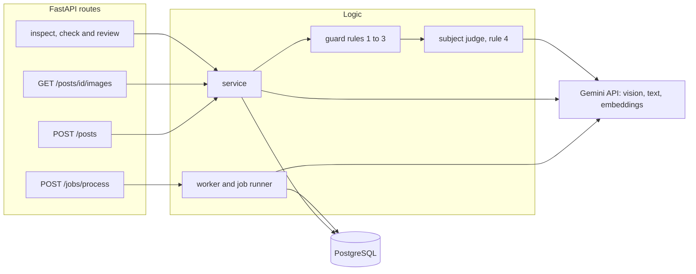

# Image Relevance and Auto-Tagging

A backend that looks at images with a vision model, tags them, and picks the best image for a blog post. It also refuses bad matches: a post about a red fox will not get a wolf photo, even when the two look similar to a computer.

Built for the FlyRank Backend AI Engineering capstone (Image Relevance and Auto-Tagging).

## How it works

1. **Tag.** Gemini looks at each image and returns JSON with a subject, category, attributes, caption and confidence. Every answer is checked against a Pydantic schema. An invalid answer is retried (up to 3 attempts, with a longer wait each time) and then marked failed. Blurry or unsure images are flagged instead of trusted.
2. **Embed.** The text description of each image (subject, caption and tags) and each post is turned into a vector with Gemini embeddings.
3. **Rank.** Images are ranked by cosine similarity to the post.
4. **Guard.** The best images go through four rules in order. The first rule that fails rejects the image, and the reason is saved:
   1. Trust: the image is not flagged, and the post has a clear subject.
   2. Category: the post and the image are in the same category.
   3. Similarity: the score is at least 0.78.
   4. Subject: a short Gemini check decides if both name the same kind of thing (a fox is not a wolf, but a golden retriever is a dog).
5. **No match.** If no image passes, the answer is "no confident match", with the reason for each rejection.
6. **Review.** A person can approve or reject any suggestion and inspect why it was chosen or refused.

## Architecture



The code has three layers. Routes are in `app/main.py`. The logic is in `service.py`, `engine.py`, `guard.py`, `judge.py`, `worker.py` and `runner.py`. The database code is in `repository.py` and `db.py`. Guard rules 1 to 3 are a small pure module that does not touch the database or the internet, so they are easy to test.

## How to run

You need Python 3.12, Docker and a Gemini API key.

```
git clone https://github.com/mahamohamedelkhatib/flyrank-capstone-image-relevance.git
cd flyrank-capstone-image-relevance
python3 -m venv .venv
source .venv/bin/activate
pip install -r requirements.txt
cp .env.example .env        # then put your Gemini key in .env
docker compose up -d        # creates all tables on a fresh database
```

The photos are not in the repo because of their licenses. Put your own images in `data/images/`, named like `fox-01.jpg`. `data/corpus.csv` lists the 42 Pexels photos I used, with the source and license of each.

```
python3 -m app.ingest       # add the images as pending rows
python3 -m app.worker       # tag every pending image with Gemini
python3 -m app.vectors      # embed the tagged images
uvicorn app.main:app        # API docs at http://127.0.0.1:8000/docs
python3 -m app.evaluate     # run the evaluation on eval/posts.csv
python3 -m app.cost_report  # totals from the AI call log
```

## API

| Endpoint | What it does |
| --- | --- |
| `POST /posts` | Add a blog post. It is tagged and embedded once. |
| `GET /posts/{id}/images` | Ranked suggestions with the guard's decision and reason. Add `?refresh=true` to recompute. |
| `POST /posts/{id}/images/{image_id}/check` | Would this one image be accepted, and why. Nothing is saved. |
| `GET /suggestions/{id}` | Why an image was selected or refused, with its tags and reviews. |
| `POST /suggestions/{id}/review` | Approve or reject a suggestion (`approved` or `rejected`). |
| `POST /jobs/process` | Start the background job that tags pending images. |
| `GET /jobs/{id}` | Progress of a job. |
| `GET /costs` | Every AI call with tokens, cost and errors. |

Bad input returns 400, a missing item returns 404, and starting a second job while one is running returns 409.

## Results

I wrote 12 posts in `eval/posts.csv`: 9 that have a matching image and 3 that should get "no confident match" (a cat, penguins and a tax post). A post counts as correct when the top match is an image of the right kind, or when the system correctly says there is no match.

| Similarity threshold | Correct | Top-1 precision |
| --- | --- | --- |
| 0.80 (first guess) | 11 of 12 | 0.92 |
| 0.78 (tuned) | 12 of 12 | 1.00 |

At 0.80 the dog post failed, because its best image scored 0.798, just under the threshold. Every correct match scored 0.798 or higher, and every no-match post scored 0.761 or lower, so I put the threshold at 0.78, inside that gap. The per-post output is in `eval/results.json`.

Similarity alone cannot tell a fox from a wolf. For a fox post the first wolf image scored 0.817, only about 0.03 below the weakest fox image. That is why the guard needs a subject check and not only a score.

Blurry photos: Gemini first gave a blurry photo a confidence of 0.95, so its own confidence could not be trusted. I changed the prompt so that confidence means how clearly the main subject is visible. That fixed two of the three blurry photos. The third is caught by a second rule: an image is flagged when its own tags say it is blurry. Tags about the background are ignored, because the first version of this rule wrongly flagged a sharp fox photo that had a soft background.

## Cost

Every Gemini call is saved in the `ai_calls` table with its tokens, estimated cost, time and any error, and `GET /costs` shows them. On 29 October 2026 the whole project had cost about $0.012: 46 vision calls ($0.0093), 61 text calls ($0.0025) and 82 embedding calls ($0.0004). That includes tagging all 42 images and the evaluation runs. Run `python3 -m app.cost_report` for the current total.

Prices are set in `.env` (`PRICE_INPUT_PER_M`, `PRICE_OUTPUT_PER_M`, `PRICE_EMBED_PER_M`) and come from a third-party price site, so the costs are estimates. Gemini does not report tokens for embeddings, so those are estimated as characters divided by 4.

## Limitations

- **Small data.** There are 42 photos from one source (Pexels) and 12 evaluation posts. I tuned the threshold on the same 12 posts, and the gap it sits in is only about 0.04 wide (0.761 to 0.798), so the 1.00 precision is optimistic. A separate held-out set of posts is the next step.
- **The subject check looks at only 3 images.** The judge runs on at most the first 3 images that pass rules 1 to 3. If the right image ranks behind three wrong ones, it is missed.
- **Category names are broad.** Fox and wolf are both "animal", so a wolf for a fox post passes the category rule and is rejected by the subject rule (reason: distinct species). The category rule catches things like a car for a fox post.
- **The subject judge is a language model.** It can be wrong or change its wording between runs, so its reason is saved for a person to check.
- **Ranking is done in Python.** Vectors are stored as arrays and compared one by one. That is fine for hundreds of images but not for millions. A vector index such as pgvector would be the next step.
- **Live API calls.** Tagging, embedding and judging call Gemini, so `POST /posts` takes a few seconds. Model names change: `gemini-2.5-flash` stopped working for new accounts during this project, so models are set in `.env`.
- **The background job is simple.** It runs inside the API process. A restart during a job can leave an image stuck as `processing`, and a job still marked running after an hour is treated as stale.
- **Narrow scope.** Only JPG images, no login, and no frontend. Review happens through the API.
- **No automated test suite.** I checked each part with scripts and the evaluation script, and the proof is in `EVIDENCE.md`.
- **Costs are estimates**, as described above.

## Credits and licenses

The photos come from Pexels (Pexels License). The source of each one is in `data/corpus.csv`. The code is under the MIT license (see `LICENSE`). I used AI help while building this project, and `BUILDLOG.md` says honestly where.
